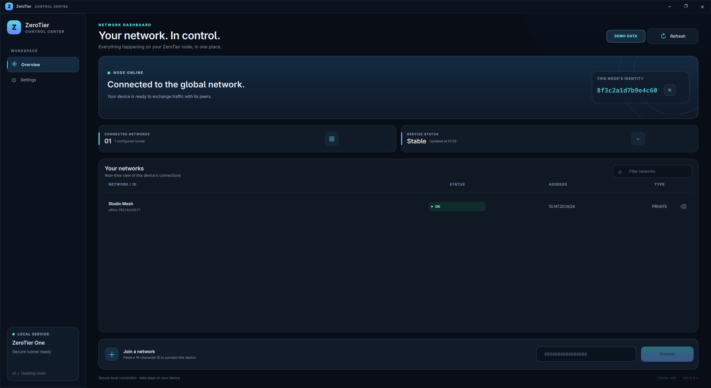

<div align="center">
  
  <h1>ZeroTier Control Center</h1>
  <p>A lightweight desktop manager for ZeroTier on Linux.</p>
</div>

<p align="center">
  
</p>

## Why I made it

I use ZeroTier a lot, but on Linux I couldn't find a lightweight graphical alternative that fit the way I wanted to manage my networks. I was tired of doing everything through the terminal, so I built ZeroTier Control Center: a simple, polished desktop interface for the ZeroTier service.

## Features

- View your node identity, service status, and joined networks.
- Join a network with its 16-character network ID, or leave a network with confirmation.
- Copy your node ID, a network ID, or an assigned IP address.
- Filter your network list and switch between English and Portuguese.
- Use a responsive interface built with C++, Qt Quick, and QML.
- Run a read-only demo with sample data for screenshots and previews.

## Requirements

- Linux with [ZeroTier One](https://www.zerotier.com/download/) installed and running.
- CMake 3.21 or newer.
- A C++17 compiler.
- Qt 6.4 or newer, including Quick, Quick Controls 2, QML, Network, and Svg.
- Polkit (`pkexec`) for authorizing access to the local ZeroTier service when the app is not run as root.

## Build and run

```bash
cmake -S . -B build
cmake --build build -j2
./build/zerotier-gui
```

The app communicates with the local ZeroTier service. Polkit authorization is requested when needed; the authorization token is kept for the current app session.

### Demo mode

To open the dashboard with sample node and network details, without accessing or changing your real ZeroTier configuration, run:

```bash
./build/zerotier-gui --demo
```

The screenshot above was captured in demo mode. The sample identity and network are fictional, and network actions are disabled in this mode.

## Install

```bash
cmake --install build --prefix "$HOME/.local"
```

This installs the executable, application launcher, and SVG icon under `~/.local`.
